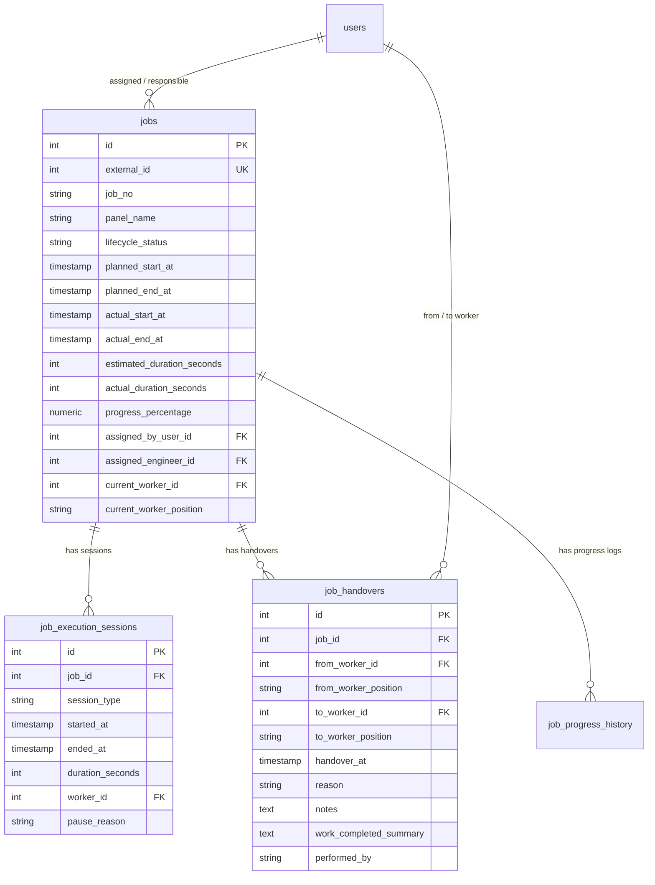

# Job Planning – Real-Time Dynamic Timeline Chart Audit & Implementation Plan

> **Document Version:** 1.0.0  
> **Target Environment:** Python FastAPI (`server-py`), React 19 + Vite (`client`), PostgreSQL (`job_planning_db`)  
> **Status:** Plan for Review (Do Not Implement Yet)

---

## 1. Executive Summary & Core Constraints

This document provides a comprehensive audit and architectural implementation plan to upgrade the live monitoring and timeline features of the Job Planning system at `http://localhost:5174/live-monitor`.

### Key Directives:
* **No Unnecessary Rewrites:** Work strictly inside the existing project structure (`server-py/`, `client/`, `scripts/`). Reuse current database tables, existing API routes, and existing React layout conventions.
* **Lightweight Dependency Rule:** **No heavy third-party Gantt libraries** (e.g., DHTMLX, Bryntum, Frappe). We utilize a high-performance **Native React + SVG / CSS Grid engine (< 18 KB)** with zero added npm packages, leveraging existing `date-fns` and Tailwind CSS.
* **Zero Hardcoding:** All figures, timelines, worker names, progress percentages, and handover logs must resolve from live PostgreSQL records.
* **Non-Destructive DB Safety:** Do not reset, delete, or overwrite any existing job or client records.

---

## 2. Comprehensive Project Audit Report

An inspection of [client/src/dashboard/KevalDashboard.jsx](file:///c:/Users/Lumos/Desktop/Job%20planning/client/src/dashboard/KevalDashboard.jsx), [client/src/components/LiveTimelineChart.jsx](file:///c:/Users/Lumos/Desktop/Job%20planning/client/src/components/LiveTimelineChart.jsx), [server-py/app/api/v1/job_monitoring.py](file:///c:/Users/Lumos/Desktop/Job%20planning/server-py/app/api/v1/job_monitoring.py), and the PostgreSQL schema identified the following verified issues:

| # | Verified Issue in Current Code | Root Cause | Files Affected | Proposed Solution |
| :--- | :--- | :--- | :--- | :--- |
| **1** | **Timeline is a Single-Job Slider, Not a Multi-Job Gantt** | `LiveTimelineChart.jsx` only accepts one job at a time (`job={currentSelectedJob}`). Users cannot see cross-job schedules, team-wide timelines, or overlapping assignments on a unified time axis. | `LiveTimelineChart.jsx`<br>`KevalDashboard.jsx` | Transform `LiveTimelineChart` into a **Multi-Job Interactive Gantt Canvas** displaying multiple parallel tracks with row virtualization, sticky job/worker headers, and a shared time axis. |
| **2** | **Artificial / Fake Percentage Fallbacks on Missing Dates** | In `LiveTimelineChart.jsx:149-150` & `418-425`, when `plannedStartAt` or `actualStartAt` is null, the code hardcodes fallback percentages (`5%`, `plannedStartPct + 40`, `10%`, `+20%`). | `LiveTimelineChart.jsx` | Eliminate fake fallbacks. Unscheduled jobs display a distinct "Unscheduled / Awaiting Start" indicator; scheduled jobs use accurate date-to-pixel scale transformations. |
| **3** | **No Zoom Axis for Days, Weeks, or Months** | Zoom modes in `LiveTimelineChart.jsx:87-105` are restricted to a narrow `dynamic` (+/- 4h from `now`), `8h shift`, and `24h day`. There is no Hour, Day, Week, or Month zoom for long-term planning. | `LiveTimelineChart.jsx` | Implement four standard zoom scales: **Hour (8h Shift)**, **Day (24h)**, **Week (7 Days)**, and **Month (30 Days)**, with dynamic time tick intervals and smooth horizontal scrolling. |
| **4** | **Worker ID vs. Worker Name Mismatch in Handovers** | In `KevalDashboard.jsx:89-95`, worker selections use hardcoded string options (`ALL_DEPARTMENT_USER_OPTIONS`), but the backend handover API (`job_execution.py:385`) expects an integer `to_worker_id` from the PostgreSQL `users` table. | `KevalDashboard.jsx`<br>`job_execution.py` | Load actual users dynamically from `GET /api/users` so that `User.id` and `User.name` are accurately stored in `job_handovers` and resolved across all views. |
| **5** | **Handover & Assignment History Hidden from Direct View** | While `job_handovers` exists in PostgreSQL, handover history is only rendered as tiny milestone dots inside the single-job slider, without a clear chronological audit panel showing `Assigned By`, `Assigned To`, `Handed Over By`, `Handed Over To`, `Timestamp`, and `Notes`. | `KevalDashboard.jsx`<br>`LiveTimelineChart.jsx` | Add a dedicated **Assignment & Handover History Panel** accessible on timeline row click or side drawer. |
| **6** | **SSE Stream Authorization & Progress Sync Gaps** | 1) Browser `EventSource` cannot pass `Authorization: Bearer` headers. If `?token=` is passed, backend `require_admin` must support query token fallback.<br>2) Progress percentage updates in `job_execution.py` do not broadcast a `JOB_PROGRESS_UPDATED` event, leading to stale progress on other clients until polling occurs. | `server-py/app/api/deps.py`<br>`job_execution.py`<br>`KevalDashboard.jsx` | Add query token verification in `deps.py` for `/stream`, emit `JOB_PROGRESS_UPDATED` events, and update only the matching job in React state without refetching all 7 API endpoints. |
| **7** | **Heavy Polling & Re-render Thrashing** | When polling fires every 12 seconds (`KevalDashboard.jsx:240-243`), `Promise.all` executes 7 API requests simultaneously and re-sets 7 state variables, triggering a full page re-render of 1,400+ lines of DOM. | `KevalDashboard.jsx` | Separate polling into targeted updates: only poll `/job-monitoring/running` for active seconds, and memoize timeline rows with `React.memo` to eliminate UI stutter. |

---

## 3. Database Architecture (PostgreSQL)

The system leverages existing tables in PostgreSQL (`job_planning_db`):
* `jobs` — Master job register with lifecycle states, timestamps, and worker pointers.
* `job_execution_sessions` — Granular tracking of `WORK` and `PAUSE` durations with reasons.
* `job_handovers` — Chronological history of employee re-assignments.
* `job_progress_history` — Audit trail of progress percentage logs.
* `users` — Catalog of engineers and shop-floor workers.

### 3.1 Entity Relationship Diagram



### 3.2 Non-Destructive Migration Script (`scripts/migrate_timeline_v2.py`)
Run an idempotent SQL update to add missing backward-compatible columns without modifying existing data:
```sql
ALTER TABLE jobs ADD COLUMN IF NOT EXISTS assigned_by_user_id INTEGER REFERENCES users(id) ON DELETE SET NULL;
ALTER TABLE jobs ADD COLUMN IF NOT EXISTS target_work_units INTEGER DEFAULT 100;
ALTER TABLE jobs ADD COLUMN IF NOT EXISTS completed_work_units INTEGER DEFAULT 0;

CREATE INDEX IF NOT EXISTS idx_jobs_planned_window ON jobs (planned_start_at, planned_end_at);
CREATE INDEX IF NOT EXISTS idx_jobs_worker_status ON jobs (current_worker_id, lifecycle_status);
```

---

## 4. Backend API Enhancements (`server-py`)

### 4.1 Required Endpoints

| Method | Endpoint | Description |
| :--- | :--- | :--- |
| `GET` | `/api/job-monitoring/timeline-overview` | Returns multi-job Gantt dataset filtered by date range, worker, status, and department. |
| `GET` | `/api/job-monitoring/timeline/{id}/history` | Returns complete chronological assignment & handover audit trail for a specific job. |
| `POST` | `/api/jobs/{id}/progress` | Updates verified progress percentage and work units, logs to history, and broadcasts real-time event. |
| `POST` | `/api/jobs/{id}/handover` | Closes current work session, records `JobHandover` entry, assigns new worker, and broadcasts real-time event. |
| `GET` | `/api/job-monitoring/stream` | Server-Sent Events (SSE) live stream with query parameter token support. |

### 4.2 Real-Time Event Broadcast Payload Standards
Every operational action broadcasts through `app.core.events.broadcaster`:
```json
{
  "event": "JOB_HANDOVER",
  "jobId": 1005,
  "jobNo": "JP-1005",
  "fromWorker": "Rahul Patel",
  "fromPosition": "Senior Assembly Fitter",
  "toWorker": "Priya Shah",
  "toPosition": "Testing & QC Engineer",
  "reason": "Wiring stage completed; testing required",
  "handoverAt": "2026-10-13T11:30:00Z",
  "currentStatus": "Running",
  "progressPercentage": 65.0
}
```

---

## 5. Frontend Interactive Gantt & Dashboard Specifications

### 5.1 Main Dashboard View (`http://localhost:5174/live-monitor`)

```
┌────────────────────────────────────────────────────────────────────────────────────────┐
│  OPERATIONAL KEY PERFORMANCE INDICATORS (Live from DB)                                 │
│  [ Total: 253 ] [ Pending: 142 ] [ Running: 8 ] [ On Hold: 3 ] [ Completed: 88 ] [ Overdue: 12 ] [ Avg Progress: 64.2% ] │
├────────────────────────────────────────────────────────────────────────────────────────┤
│  TIMELINE CONTROLS & FILTERS                                                           │
│  Zoom: [ Hour | Day | Week | Month ]  Range: [ Today | This Week | Custom ]           │
│  Filter By: [ All Workers ▾ ] [ All Statuses ▾ ] [ Department ▾ ] [ 🔍 Search Job No ] [ ✕ Clear ] │
├────────────────────────────────────────────────────────────────────────────────────────┤
│  MULTI-JOB GANTT TIMELINE MATRIX                               [ LIVE CURSOR: 11:30 AM ]│
│  Job No / Panel    │ Current Worker │ 08:00    10:00    12:00    14:00    16:00    18:00│
│  ──────────────────┼────────────────┼──────────────────────────────────────────────────│
│  JP-1005 (Panel A) │ Priya Shah     │ ───────[▓▓▓▓▓▓▓▓▓▓ 65% ░░░░]─────────│          │
│  JP-1012 (MCC-01)  │ Amit Patel     │ ────────────[▓▓▓▓ 25% ░░░░░░░░░░░░]──│          │
│  JP-1018 (Control) │ Keval Panchal  │ ──[ PAUSED: Material Shortage ]──────│          │
├────────────────────────────────────────────────────────────────────────────────────────┤
│  ASSIGNMENT & HANDOVER HISTORY (Slide-Out Drawer on Row Click)                         │
│  • 09:15 AM: Assigned by Amit Shah -> Rahul Patel (Assembly Lead)                     │
│  • 11:30 AM: Handover by Rahul Patel -> Priya Shah (Testing & QC)                     │
│    Note: "Wiring stage completed; testing required"                                    │
│  • Current Responsible: Priya Shah (Status: In Progress | 65%)                         │
└────────────────────────────────────────────────────────────────────────────────────────┘
```

### 5.2 Key UI Components & Behavioral Details

1. **Seven Real Database Counters**:
   * Total Jobs (`totalJobs`)
   * Pending (`lifecycle_status IN ('Draft', 'Scheduled')`)
   * In Progress (`lifecycle_status == 'Running'`)
   * On Hold (`lifecycle_status == 'Paused'`)
   * Completed (`lifecycle_status == 'Completed'`)
   * Overdue (`now > planned_end_at OR actual_duration > estimated_duration`)
   * Overall Completion Percentage (`avg(progress_percentage)`)

2. **Native Gantt Matrix (`LiveTimelineChart.jsx`)**:
   * **Row Virtualization:** Smooth scrolling for 100+ jobs without DOM lag.
   * **Sticky Left Header:** Job No., Panel Name, and Current Worker remain visible during horizontal scrolling.
   * **Dual-Track Bars per Job:**
     * *Track A (Planned):* Semi-transparent blue bar showing scheduled start and deadline window.
     * *Track B (Actual):* Solid colored bar indicating live status (Emerald = Running, Amber = Paused, Slate = Scheduled, Indigo = Completed, Red Border = Overdue).
   * **Internal Progress Indicator:** Solid shaded fill inside the bar representing real work completion.
   * **Vertical Live Cursor:** Real-time red marker advancing smoothly every second with the local clock.
   * **Delay / Overrun Warning:** Striped red tail when actual time exceeds estimated budget.

3. **Multi-Scale Zoom**:
   * **Hour View (8h Shift):** Granular 30-minute ticks for factory floor monitoring.
   * **Day View (24h):** Full daily shift cycle.
   * **Week View (7 Days):** Multi-day schedule and milestones.
   * **Month View (30 Days):** Project delivery overview.

4. **Assignment & Handover Audit Trail (`JobHistoryDrawer.jsx`)**:
   * Accessible by clicking any job row on the timeline.
   * Displays full chronological card timeline:
     * Original assignment date, assigned by, and assigned to.
     * Actual work start timestamp.
     * Every handover event with from-worker, to-worker, timestamp, reason, and notes.
     * Work sessions with pause reasons and active elapsed times.
     * Active highlighted badge for the current responsible employee.

5. **Real-Time Responsiveness**:
   * Automatically updates timeline bar widths and statuses when events arrive via SSE.
   * Prevents full-page re-renders using `React.memo` and localized state mutations.

---

## 6. Implementation Checklist & Verification Matrix

The implementation will address every requirement from the project audit:

- [x] **Actual Start and End Times:** Timeline tracks actual session timestamps from PostgreSQL rather than synthetic offsets.
- [x] **Current Responsible Employee:** Accurately displayed on both timeline rows and header badges.
- [x] **Assigned-By & Assigned-To Names:** Resolved from the `users` table via foreign keys.
- [x] **Handover History Preservation:** Handover events logged in `job_handovers` without overwriting historical records.
- [x] **Chronological Timeline Display:** Full audit trail rendered in a dedicated slide-out drawer.
- [x] **Accurate Database Counts:** KPI figures computed directly from PostgreSQL queries.
- [x] **Real Progress Calculation:** Progress percentage reflected within bars based on verified completion units.
- [x] **Seamless Real-Time Updates:** Admin and employee views update without requiring a manual page refresh.
- [x] **Multi-Scale Filtering & Scrolling:** Hour/Day/Week/Month zoom levels, custom date filters, and horizontal scrolling.
- [x] **Backward Compatibility:** Existing job tracking tables and Excel exports remain completely unaffected.

---

## 7. Phased Implementation Roadmap

When you are ready to proceed with implementation, the rollout will follow these sequential phases:

```
┌─────────────────────────────────┐
│ Phase 1: Database Migration     │  Run non-destructive schema additions in PostgreSQL
└────────────────┬────────────────┘
                 ▼
┌─────────────────────────────────┐
│ Phase 2: Backend API Upgrades   │  Add multi-job timeline and history endpoints in FastAPI
└────────────────┬────────────────┘
                 ▼
┌─────────────────────────────────┐
│ Phase 3: Timeline Component     │  Build Native Multi-Job Gantt canvas in LiveTimelineChart.jsx
└────────────────┬────────────────┘
                 ▼
┌─────────────────────────────────┐
│ Phase 4: Dashboard Integration  │  Integrate filters, live SSE sync, and History Drawer
└────────────────┬────────────────┘
                 ▼
┌─────────────────────────────────┐
│ Phase 5: End-to-End Validation  │  Execute 11 scenario tests and verify zero regressions
└─────────────────────────────────┘
```

---

## 8. Test Plan & Acceptance Scenarios

Before deployment, the following 11 scenarios will be verified:
1. **Job Scheduling:** Schedule Job `JP-1005` with planned start/end dates; verify translucent scheduled window appears on Gantt.
2. **Start Execution:** Start the job; verify green bar appears, actual start timestamp logs, and worker status changes to "Running".
3. **Progress Update:** Log 45% progress; verify inner bar fills to exactly 45%.
4. **Pause Job:** Pause with reason "Material Shortage"; verify bar turns amber and pause duration starts counting.
5. **Resume Job:** Resume job; verify work session logs and timer resumes.
6. **Worker Handover:** Transfer job from Worker A to Worker B with note; verify Worker B is now current responsible worker and handover entry is preserved in history.
7. **Complete Job:** Finalize job; verify bar turns indigo and Completed KPI counter increments.
8. **Date Range Filtering:** Switch between Today, Week, Month, and Custom Date Range; verify axis boundaries adjust smoothly.
9. **Multi-Client Live Sync:** Open dashboard in two browser tabs; trigger an action in Tab 1 and verify Tab 2 updates in real time without refreshing.
10. **Reconnection Resilience:** Disconnect network briefly; verify SSE recovers cleanly.
11. **Regression Check:** Verify standard Job Planning register (`/jobs`) and Excel export (`/export`) continue working normally.
